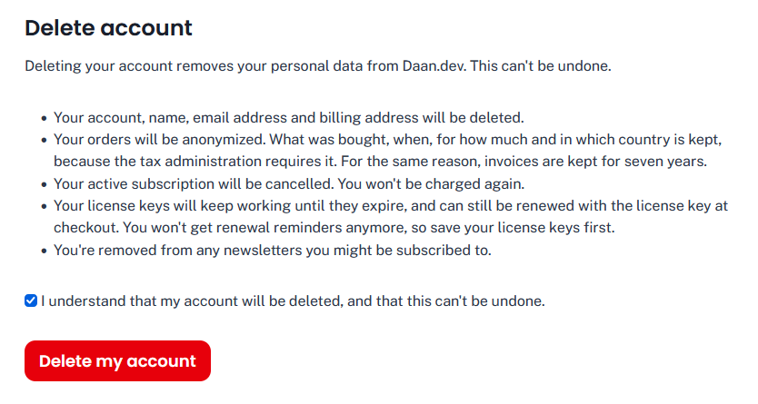

# Delete Account for Easy Digital Downloads

Lets customers delete their own Easy Digital Downloads account (GDPR's right to erasure), with a **Delete Account**
block you place on e.g. your Account page, below the profile editor.

The block lists what deleting the account does, and asks to confirm with a checkbox. Its heading, introduction, list,
checkbox label and button text are edited in the block editor, and it supports borders, colors and spacing.
`{site_name}` is replaced with your site's name. The block is only shown to logged-in customers.

## What happens when a customer deletes their account

1. Their active subscriptions (EDD Recurring) are cancelled at the payment gateway, so they're not charged again. If
   that fails, the account isn't deleted, and you're notified.
2. Their license keys (EDD Software Licensing) are detached from the account: they keep working until they expire, and
   can still be renewed with the license key at checkout.
3. WordPress' personal data erasers run (the same as Tools > Erase Personal Data): EDD anonymizes the customer and their
   download logs, reviews, comments and AffiliateWP customer records, and anonymizes or deletes their orders depending
   on each order's status (see below). If Brevo for EDD is set up, the contact is deleted from Brevo.
4. The WordPress user is deleted and logged out, and sees a confirmation.
5. You get an email with what was done, and which erasers failed, if any. If the email can't be sent, the report goes
   to PHP's error log.

Staff, affiliates (AffiliateWP) and customers with orders EDD may not change (e.g. still processing) can't delete their
account here: they're asked to contact you.

## Orders

What happens to a customer's orders depends on their status, as set in **Downloads > Settings > Policies > Privacy >
Order Statuses**. By default:

| Status | Default | |
|---|---|---|
| Complete, Refunded, Revoked, Pending | Anonymize | Name, address lines and email address are removed; what was bought, when, for how much, and the city, postcode and country are kept, for taxes. |
| Failed, Abandoned | Delete | Never paid. |
| Processing | Do Nothing | The customer can't delete their account here. |
| Renewal (EDD Recurring) | Same as Complete | Unless you set it yourself: if it's Do Nothing, customers with a renewal can't delete their account here. |

You can change this per status (Anonymize, Delete or Do Nothing) in **Downloads > Settings > Policies > Privacy > Order
Statuses**.

## Installation

1. Download the zip from the [latest release](https://github.com/Dan0sz/edd-delete-account/releases/latest), upload it
   in Plugins > Add New and activate it.
2. Add the **Delete Account** block to your Account page, e.g. below the profile editor, and enter the URL of your
   contact page in its settings.
3. Check **Downloads > Settings > Policies > Privacy > Order Statuses**: EDD only anonymizes a customer if all of their
   orders may be anonymized or deleted, so set e.g. Renewal to Anonymize.

## Hooks

| Hook | Type | |
|---|---|---|
| `edd_delete_account_customer_roles` | filter | Roles of users who can delete their own account. Default: `subscriber`, `edd_subscriber`, `customer`. |
| `edd_delete_account_blocked_reason` | filter | Why a customer can't delete their account (empty if they can). |
| `edd_delete_account_notification_recipient` | filter | Who's emailed. Default: the site's admin email address. |
| `edd_delete_account_notification_lines` | filter | The lines of that email. |
| `edd_delete_account_before` | action | Before the account is deleted (subscriptions are already cancelled). |
| `edd_delete_account_deleted` | action | After the account was deleted. |

## Development

No build step: the block's editor script is plain JavaScript. After adding a class, run `composer dump-autoload`.
